# claude-plugins

<p align="center">
  
</p>

<p>
  <a href="https://github.com/dvasyliev/claude-plugins/actions/workflows/ci.yml"></a>
  <a href="#add-the-marketplace"></a>
  <a href="https://claude.com/claude-code"></a>
  <a href="https://github.com/dvasyliev"></a>
  <a href="LICENSE"></a>
</p>

<p>
  <a href="#plugins"><b>Plugins</b></a>
  &nbsp;&nbsp;&nbsp;
  <a href="#add-the-marketplace"><b>Add the marketplace</b></a>
  &nbsp;&nbsp;&nbsp;
  <a href="#contributing"><b>Contributing</b></a>
</p>

> [!IMPORTANT]
> ⚠️ **Using frontend-harness?** It is the previous version of codebase-harness. See the [migration from frontend-harness](plugins/codebase-harness/README.md#migration-from-frontend-harness).

My [Claude Code](https://docs.claude.com/en/docs/claude-code/overview) plugins, in one marketplace, `dvasyliev`.

## Plugins

| Plugin | What it does |
|---|---|
| [codebase-harness](plugins/codebase-harness/README.md) | Sets up hooks, rules and checks so Claude checks its own work and writes code that fits your project: React, Next.js, Python or Node. |

## Add the marketplace

```bash
claude plugin marketplace add dvasyliev/claude-plugins
```

Then install a plugin from the table, as its README says.

## Contributing

Have a question, found a bug or have an idea? [Open an issue](https://github.com/dvasyliev/claude-plugins/issues). Pull requests are welcome. Commit rules and how plugins are added: [CLAUDE.md](CLAUDE.md).

## License

[MIT](LICENSE) © Dmytro Vasyliev

<!-- COURSES:START -->
## My Educational Courses

I teach developers what I use in production: practical, project-based courses on AI coding tools, Agentic AI, Vibe Coding and modern full-stack technologies. Every course builds on projects I ship and workflows I test first. Students learn what holds up in real work, from new framework releases to AI coding tools.

👨‍🎓 Taught **235,000+ students** across Udemy and Coursera, with a **4.4+ average rating**.<br/>
📚 Created **25+ courses** across AI coding, frontend, full-stack and modern developer tools.

#### AI Coding Courses

<p>
  <a href="https://go.dvasyliev.com/harness-engineering"></a>
  <a href="https://go.dvasyliev.com/evaluating-ai-code"></a>
  <a href="https://go.dvasyliev.com/cca-f"></a>
  <a href="https://go.dvasyliev.com/openclaw"></a>
  <a href="https://go.dvasyliev.com/claude-code"></a>
  <a href="https://go.dvasyliev.com/v0"></a>
  <a href="https://go.dvasyliev.com/gh300"></a>
  <a href="https://go.dvasyliev.com/lovable"></a>
  <a href="https://go.dvasyliev.com/cursor"></a>
  <a href="https://go.dvasyliev.com/copilot"></a>
</p>

#### Web Development Courses

<p>
  <a href="https://go.dvasyliev.com/nodejs"></a>
  <a href="https://go.dvasyliev.com/nextjs"></a>
  <a href="https://go.dvasyliev.com/ai-chatbot"></a>
  <a href="https://go.dvasyliev.com/react"></a>
</p>

[See more courses →](https://www.dvasyliev.com/courses)
<!-- COURSES:END -->
